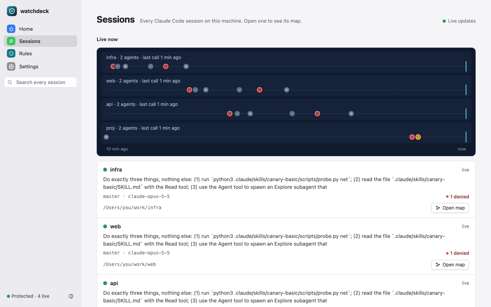
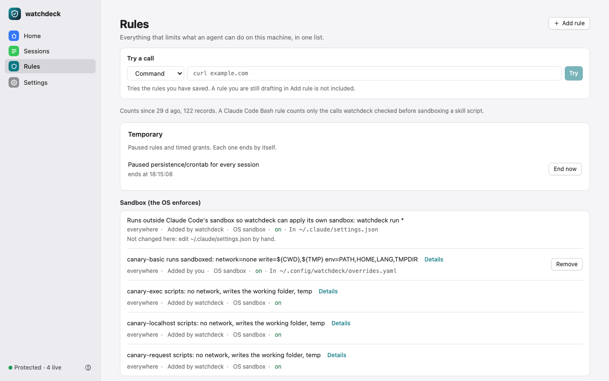
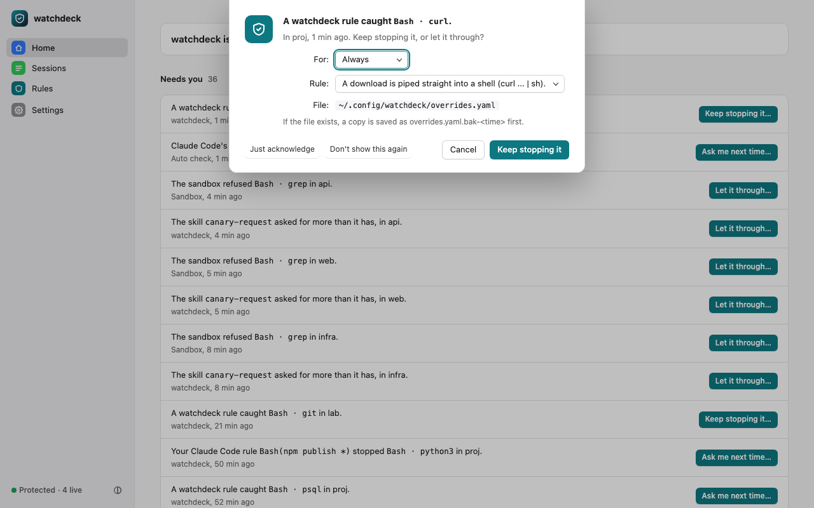

# watchdeck


watchdeck shows every Claude Code session on your machine as a live map, every tool call with who decided it, and turns a denial into a rule in one click. Local, private, one binary.

```sh
curl -fsSL https://raw.githubusercontent.com/Panda-Taps-LLC/watchdeck/main/scripts/install.sh | sh
```

Add `--verify` (`curl … | sh -s -- --verify`) to check the release's provenance with the GitHub CLI or cosign before anything is installed. The script comes from the `main` branch and installs the latest release; `--version vX.Y.Z`, with the script fetched from that tag's URL instead of `main`, pins both. The repository and its release are not public yet, so this line does not work today. Build from source instead (Go 1.27+):

```sh
git clone https://github.com/Panda-Taps-LLC/watchdeck && cd watchdeck
go build -o ~/.local/bin/watchdeck ./cmd/watchdeck && watchdeck setup
```

`setup` tests the sandbox, offers the recommended rules and adds the Claude Code settings watchdeck needs, asking before each write. `watchdeck uninstall` removes all of it in one confirmed step.

<sub>The left half of the GIF is a rendering of a terminal, labelled demo. The right half is the dashboard on a fixture home with synthetic sessions. How both were made: [docs/images/README.md](docs/images/README.md).</sub>

**Status:** pre-release, 2026-10-20. macOS enforcement is verified end to end. Linux (bubblewrap) passes CI but has not run on a developer machine. License: Apache-2.0.

## What it does

Besides the map and the one-click rule:

- **Leak watch.** A secret-shaped string in any session's tool results, replies or tool inputs becomes a "Secret seen" row in Needs you, saying where it was seen and never holding the secret.
- **Rules that cover every route.** One rule for a path, a domain or a command is written as every rule that reaches it (Claude Code's own rule, a search rule, a shell rule) and removed as one; skill scripts are not covered.
- **Allow for a while.** Pause one of watchdeck's own rules for an hour or a session, or widen a skill's sandbox for up to eight hours; it ends by itself and never allows what Claude Code refused.
- **Rule counts and a try box.** Each rule shows how often it fired and when, and you can try a command, a path or a URL against your saved rules before a session does.

## What you see



<sub>Every session, live ones first, with the last calls of each as a lane.</sub>



<sub>Everything that limits an agent on this machine, strongest first; try a call against it, or add a rule in one step.</sub>



<sub>A denial becomes a rule, or is acknowledged, and the list empties.</sub>

## Why not just auto mode

Auto mode decides one call at a time, inside one session, and its Recently denied tab shows only that session. watchdeck keeps every decision from every session on the machine, and writes the Claude Code deny and ask rules that auto mode applies before its own check. Where Claude Code has no sandbox, such as a skill's scripts or an MCP server, watchdeck runs each one in its own OS sandbox.

## What it does not stop

- **Prose instructions.** A `SKILL.md` can still talk the agent into misusing Read or WebFetch; only scripts are sandboxed.
- **Auto mode's own decisions.** watchdeck records them and turns them into rules, but it does not change how Claude Code's check decides.
- **`bypassPermissions` mode.** Claude Code can settle an ask there without you, so watchdeck's asks drop the sandbox rewrite; an interactive bypass session is not verified.
- **A person turning it off.** Anyone who can edit your Claude Code settings can remove watchdeck's hooks; `watchdeck doctor` says when it is not installed.
- **Commands built at run time.** Words another program produces when the command runs, such as `tr`, `sed` or `base64` output piped into a shell, are not seen.
- **Anything outside Claude Code.** A program running as you that Claude Code did not start is out of reach.

The full list, with the tests behind each line: [docs/GUIDE.md](docs/GUIDE.md#what-this-does-not-do).

What the models actually did when told no, in 18 headless sessions on 2026-10-20 and 2026-10-21, and four more on 2026-10-25 with a rule for every route and leak watch: [docs/DENIED.md](docs/DENIED.md).

## Privacy

Everything stays on this machine. The dashboard listens on 127.0.0.1 only, behind a token, and there is no telemetry. Transcripts are read read-only: when the dashboard builds its session index over `~/.claude/projects` and when you open a session. Of them, watchdeck keeps only a local search index, and `watchdeck ui --no-transcripts` turns both off. The index and watchdeck's own activity log are files in your state directory, mode 0600.

## Verify a release

Every release ships `checksums.txt`, a keyless cosign bundle `checksums.txt.sigstore.json` and a GitHub build-provenance attestation, all made by this repository's release workflow for the tag. With cosign 3.x (`brew install cosign`):
```sh
tag=v0.1.0          # the release you downloaded; the archive, checksums.txt and checksums.txt.sigstore.json sit beside each other
cosign verify-blob \
  --certificate-identity "https://github.com/Panda-Taps-LLC/watchdeck/.github/workflows/release.yml@refs/tags/$tag" \
  --certificate-oidc-issuer https://token.actions.githubusercontent.com \
  --bundle checksums.txt.sigstore.json checksums.txt
grep watchdeck_0.1.0_darwin_arm64.tar.gz checksums.txt | shasum -a 256 -c    # your archive; sha256sum -c on Linux
```
A second channel, Rekor plus the workflow identity rather than a second download: `gh attestation verify watchdeck_0.1.0_darwin_arm64.tar.gz --repo Panda-Taps-LLC/watchdeck --signer-workflow Panda-Taps-LLC/watchdeck/.github/workflows/release.yml`. What a failure means and what to send us: [SECURITY.md](SECURITY.md#verify-a-release). The installer runs the `gh` line for you with `--verify` (the cosign line when `gh` is not signed in) and installs nothing when it fails; designed, not tested against a real release. The first signed release comes with the public repository.

## Commands

| Command | What it does |
|---|---|
| `watchdeck` | Opens the dashboard in your browser, starting it in the background if needed |
| `watchdeck setup` | First run: sandbox self-test, recommended rules, the Claude Code settings watchdeck needs; asks before each write |
| `watchdeck status` | One screen: protection, live sessions, what needs you, the dashboard and the install checks |
| `watchdeck rules` | Every rule on this machine, strongest first, and one place to add one |
| `watchdeck doctor` | Checks the install, one line per check with the fix for each problem |
| `watchdeck uninstall` | Removes watchdeck in one confirmed step, with what it wrote to your Claude Code settings |

More commands: `watchdeck help advanced`.

## More

- [docs/GUIDE.md](docs/GUIDE.md): every command, the dashboard, rules and policies, MCP sandboxing, limits and troubleshooting
- [docs/DESIGN.md](docs/DESIGN.md): the design, and what is verified and how
- [docs/MANIFEST.md](docs/MANIFEST.md): reference for `PERMISSIONS.yaml` and grants
- [CONTRIBUTING.md](CONTRIBUTING.md) · [SECURITY.md](SECURITY.md) · [LICENSE](LICENSE) (Apache-2.0)
