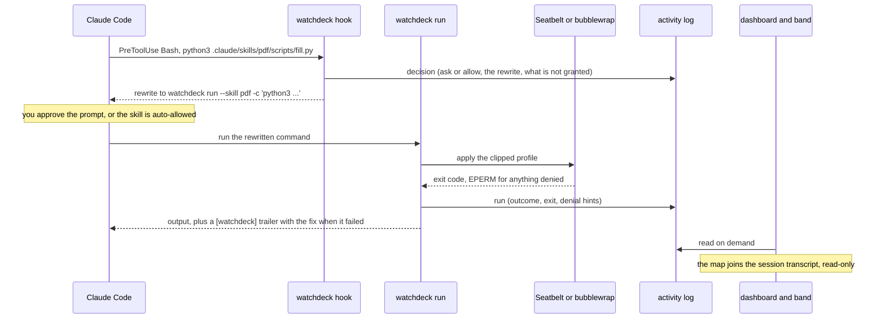
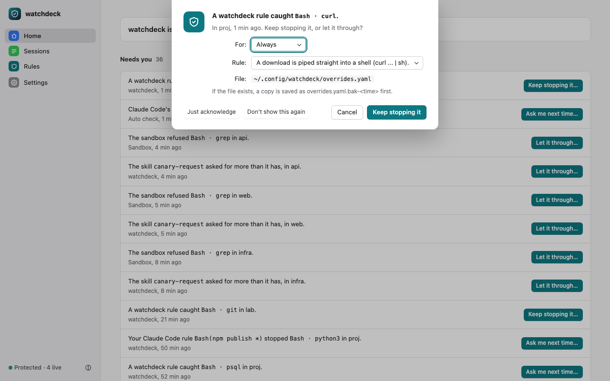
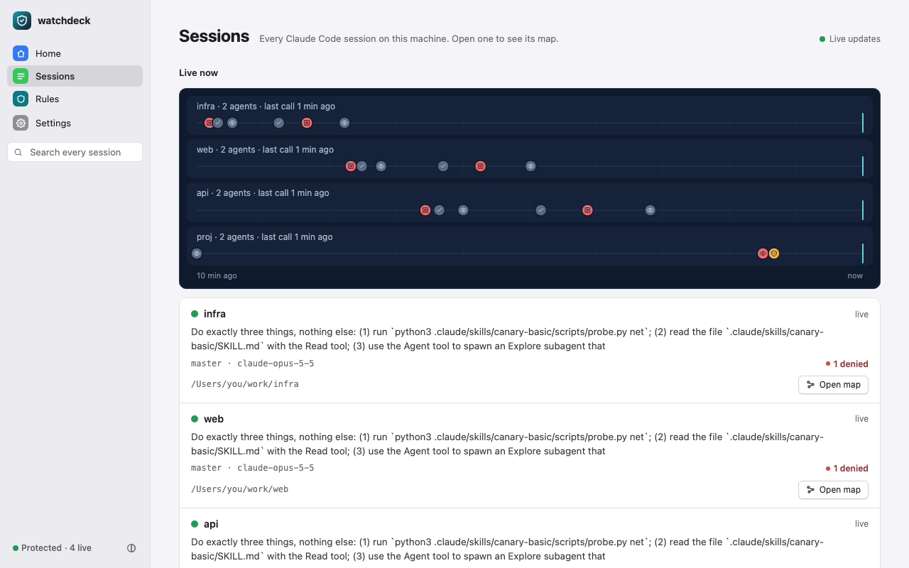
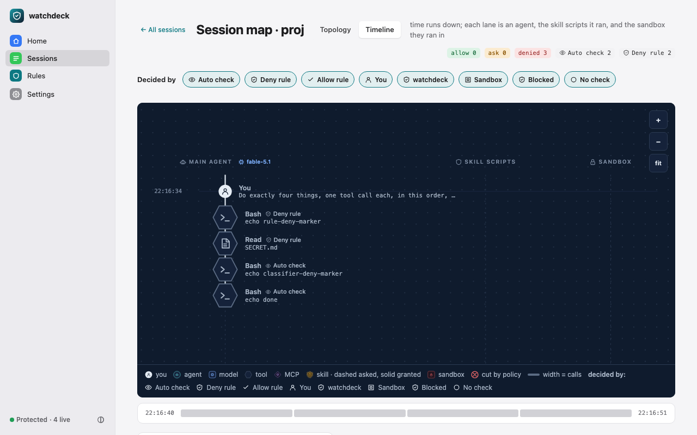
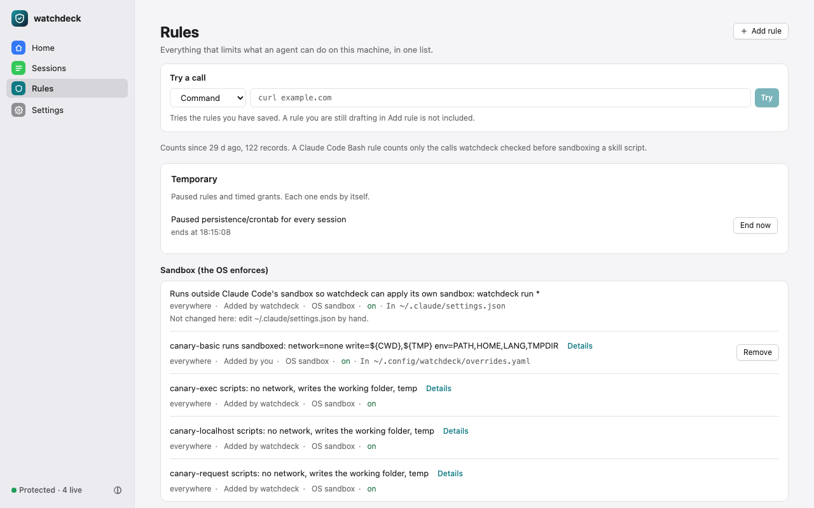
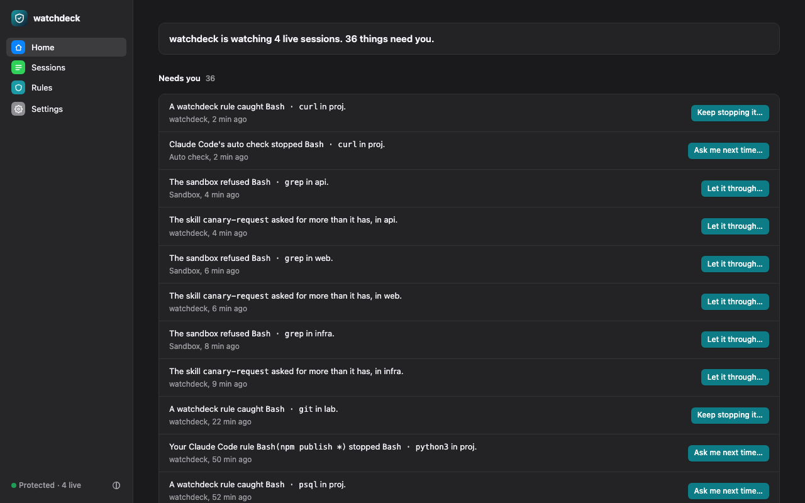
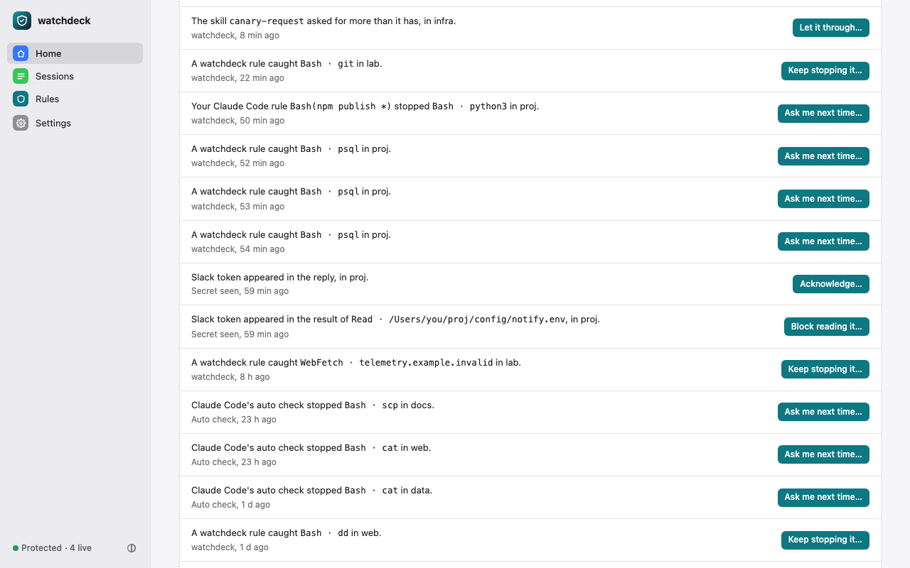
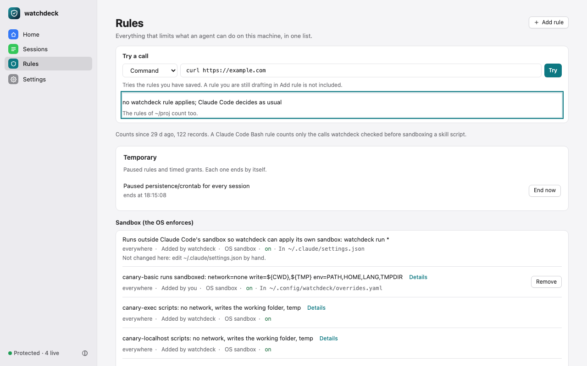

# watchdeck guide

The README is the short version. This is everything else: the full install and uninstall story, how the pieces fit, every command, policies beyond skills, sandboxing MCP servers, limits and troubleshooting. The manifest schema is in [`MANIFEST.md`](MANIFEST.md); the design of record, with what was verified and how, is [`DESIGN.md`](DESIGN.md).

- [Install, set up, uninstall](#install-set-up-uninstall)
- [How it works](#how-it-works)
- [The dashboard](#the-dashboard)
- [Policies beyond skills](#policies-beyond-skills)
- [Rules](#rules)
- [Leak watch](#leak-watch)
- [Rules that cover every route](#rules-that-cover-every-route)
- [Allow for a while](#allow-for-a-while)
- [Rule stats and trying a call](#rule-stats-and-trying-a-call)
- [Commands](#commands)
- [Sandboxing MCP servers (experimental)](#sandboxing-mcp-servers-experimental)
- [Platform support](#platform-support)
- [What this does not do](#what-this-does-not-do)
- [Troubleshooting](#troubleshooting)
- [Against Claude Code's own controls](#against-claude-codes-own-controls)
- [Roadmap](#roadmap)
- [Development](#development)

## Install, set up, uninstall

**Install and set up (one command).**

```
curl -fsSL https://raw.githubusercontent.com/Panda-Taps-LLC/watchdeck/main/scripts/install.sh | sh
```

`scripts/install.sh` downloads `watchdeck_<version>_<darwin|linux>_<arm64|amd64>.tar.gz` and `checksums.txt` from the GitHub release, refuses on a sha256 mismatch, installs the binary in `~/.local/share/watchdeck/bin` (no sudo), links it into `~/.local/bin` when that directory is on your PATH, and then runs `watchdeck setup` on your terminal. `--no-setup` skips that last step, `--yes` answers its questions with the defaults, `--version vX.Y.Z` pins a release. Add `--verify` (`curl … | sh -s -- --verify`, or `WATCHDECK_VERIFY=1`) to check the release's provenance with the GitHub CLI or cosign before anything is installed: with `gh` signed in it runs `gh attestation verify` on the archive against this repository's release workflow; otherwise, with cosign 3.x, it checks the keyless bundle on `checksums.txt` for the release's tag; with neither it refuses, and nothing is installed when any check fails. The script comes from the `main` branch and installs the latest release; `--version vX.Y.Z`, with the script fetched from that tag's URL instead of `main` (`https://raw.githubusercontent.com/Panda-Taps-LLC/watchdeck/vX.Y.Z/scripts/install.sh`), pins both. To read it first: `curl -fsSLO …/install.sh && less install.sh && sh install.sh`.

Or from the Homebrew tap, whose formula is updated with each release:

```
brew install Panda-Taps-LLC/tap/watchdeck
```

Or, typed inside Claude Code, the plugin, which gives the band above the prompt, `/watchdeck:open` and `/watchdeck:status`; it needs the binary too, so it comes after one of the two installs above:

```
/plugin install watchdeck --marketplace Panda-Taps-LLC/watchdeck
```

The repository is private and there is no release yet (2026-10-20), so the three lines above work once the owner publishes both. The installer is tested against a fake local release (`scripts/test-install.sh`, 14 cases, with stubs standing in for `gh` and cosign), not against GitHub; the verify step is designed, not tested against a real release, until the first public tag. `checksums.txt` comes from the same release as the archive, so the sha256 check alone catches a corrupt or truncated download, not a tampered release; `--verify` checks that (see [`SECURITY.md`](../SECURITY.md#verify-a-release), "Verify a release"). For maintainers, `scripts/verify-release.sh <tag>` runs both blocks and the checksum on every archive of a release. Until then, build from source (Go 1.27 or later):

```
git clone https://github.com/Panda-Taps-LLC/watchdeck && cd watchdeck
go build -o ~/.local/bin/watchdeck ./cmd/watchdeck && watchdeck setup
```

**What `setup` does.** It checks that the sandbox works on this machine, shows a short audit of your installed skills, offers the twelve recommended Claude Code rules (a No is remembered, so it does not ask again; see [Rules](#rules)), and, after you confirm, registers the hooks in your Claude Code settings (backup `settings.json.bak-<timestamp>`) and adds the sandbox exclusion. If the plugin is installed and enabled (or you pass `--plugin`, for `claude --plugin-dir`), it adds only the exclusion. Without a terminal it prints the plan and changes nothing unless you pass `--yes`. Last, it asks "Start the dashboard automatically with each Claude Code session? [y/N]" and saves the answer in `~/.config/watchdeck/config.yaml`. With yes, the SessionStart hook starts the dashboard in the background when a Claude Code session starts; `WATCHDECK_UI_AUTOSTART=off` turns that off, and so does `WATCHDECK_LIFECYCLE=off`. To have it from login instead, `watchdeck service install` makes it a login service (launchd on macOS, systemd `--user` on Linux).

**See it work.** `watchdeck demo` runs a bundled canary skill that asks for network, in a throwaway directory under `/var/tmp` with its own HOME, config, Claude Code settings and activity log, prints what the sandbox denied and the trailer that tells the agent so, and offers to open the dashboard on that tree. It needs `python3`.

**Open the dashboard.** `watchdeck` on its own (or `watchdeck ui`) opens your browser on a `127.0.0.1` port with a link that carries the token. One dashboard runs per user: if one is already running, `watchdeck ui` opens that one. Started from a terminal it exits after 30 idle minutes; started with `--ensure` or as a service it keeps running until `watchdeck ui --stop`. The token and port stay the same across restarts (`watchdeck ui --rotate-token` replaces the token), and "Remember me on this computer" in Settings keeps the token in that browser. `watchdeck status` gives the same overview in the terminal.

**Use Claude Code as usual.** When the agent runs a skill's script, the prompt shows the command rewritten to `watchdeck run --skill <name> -c '…'` and the policy it will run under.

**When something is off, run `watchdeck doctor`.** It checks for missing or duplicate hooks, the sandbox exclusion against Claude Code's own sandbox setting, whether the binary is on your PATH, when the hook last fired, and a sandbox self-test; it exits 1 if anything is wrong. `watchdeck doctor --prove` goes further and exercises the registered hook end to end (a rewrite, a sandboxed network denial, a denied Read, shadow off) in a throwaway tree under `/var/tmp`, from your user-scope settings only; it runs the binary your settings name, not Claude Code itself, so it proves the hook's answers, not that Claude Code calls it for every tool. [Troubleshooting](#troubleshooting) lists the common cases by hand.

**Uninstall (one command).** `watchdeck uninstall` prints what it will remove, asks once, then stops the dashboard, removes the login service, unwraps any MCP server it wrapped, removes the hooks and the sandbox exclusion from your Claude Code settings (with a backup), removes the rules it added from every settings file it recorded them in (a project's `.claude/settings.json` included; rules you wrote stay), turns dashboard autostart off and, last, deletes the binary if the installer put it in `~/.local/share/watchdeck/bin` (a Homebrew or `go build` binary gets a hint instead). Your grants (`~/.config/watchdeck/overrides.yaml`) and the activity log stay unless you add `--purge`. `--purge` keeps the state dir when a rule watchdeck added could not be removed (its file is missing or unreadable, or the write failed) or its record of those rules does not load, so you can fix that and rerun. `--dry-run` shows the plan and changes nothing; `--project` also cleans the current project's `.claude/settings.json`. If the plugin is installed, it tells you to remove it with `claude plugin uninstall watchdeck`.

### Plugin instead of hooks in settings

`claude --plugin-dir <repo>/plugin` loads the Claude Code plugin today (hooks, slash commands, the band above the prompt). It registers the hooks itself, so do not also register them from settings: that would run them twice. It cannot set Claude Code's `sandbox.excludedCommands`: if Claude Code's own Bash sandbox is on, add `"watchdeck run *"` there yourself (or run `watchdeck setup --plugin`, which adds only that), or every skill run exits 126. A marketplace install comes when the repository is public.

## How it works



1. `watchdeck audit` finds every installed skill (`~/.claude/skills`, project `.claude/skills`, enabled plugins, `~/.agents/skills`) and reports what its scripts reference: network, credential paths, subprocesses, environment, encoding.
2. A `PreToolUse` hook on Bash rewrites any command that runs a skill's script to `watchdeck run --skill <name> -c '<command>'` and shows it to you with the effective policy. Commands that touch no skill get no opinion.
3. `watchdeck run` applies the per-skill sandbox: Seatbelt on macOS, bubblewrap on Linux. Under the default profile a script can write only to the project directory and temp, has no network, cannot read `~/.ssh`, `~/.aws`, `~/.gnupg`, `~/.claude`, `~/.config/gcloud`, `~/.netrc`, `~/.docker/config.json`, watchdeck's own state dir (`${XDG_STATE_HOME:-~/.local/state}/watchdeck`: the activity log and session index), Claude Code's user config `~/.claude.json` and its backups (they hold MCP server tokens; also under `$CLAUDE_CONFIG_DIR`, and `$CLAUDE_CONFIG_DIR` itself when you moved it away from `~/.claude`) or any `.env` file (since 2026-10-14 a script can neither read nor create, rename or delete one, so a rename cannot get around the read deny; these paths are taken from your account's home in the user database as well as from `$HOME`, so `HOME=/elsewhere` does not move them), and sees only `PATH`, `HOME`, `LANG` and `TMPDIR` (plus `WATCHDECK_PROFILE`, which `run` sets to mark that a sandbox is already applied).
4. Each hook decision and each run outcome is appended to a local activity log. The dashboard and the in-session band read it. Since 2026-10-19 the `PermissionDenied` hook runs for every tool, so an auto-mode denial of any call (a file read, a fetch, an MCP tool, a command) is logged too; for a command that touches no skill the record keeps the program name only, and a denial reason that quotes the command shows that name followed by " …" in its place (`TestPermissionDeniedAllTools`, `TestDeniedBashKeepsArgv0Only`).

Request, grant, clip:

- A skill's `PERMISSIONS.yaml` is a **request**. It never grants anything by itself.
- Your **grant** is the default profile, widened only by your own overrides (`watchdeck allow`, or Grant on the dashboard).
- `run` executes under the field-by-field minimum of the two.
- A request for more than you granted never makes a run fail. The extra items are named in `audit`, in the prompt, and in the trailer.
- When a run fails because of the policy, the trailer prints the exact `watchdeck allow` line that would grant more.

Prose is declared only. The sandbox applies to script execution, not to what `SKILL.md` tells the agent to do with its own tools. The schema, the clip rules and the overrides file are in [`MANIFEST.md`](MANIFEST.md).

## The dashboard

The dashboard has three tabs, Home, Sessions and Rules, and a Settings gear. The pill in the top bar says whether you are protected and how many sessions are live. Old links to the Overview, Skills, Grants, Enforce and Flow pages still work: they land on the page that replaced them.

**Home** opens with one sentence: watchdeck is not installed yet (with Turn it on), is watching but not enforcing (with a link to Settings), or is watching N live sessions and M things need you. Below it:

- **Needs you** lists what happened since install that you may want to act on: auto-mode denials, watchdeck's own asks and blocks, sandbox refusals, skills asking for more than you granted, and secrets seen in a transcript ([Leak watch](#leak-watch)). Each item is one sentence ("Claude Code's auto check stopped Bash · curl in api.") with who decided, when and why under it, and one button that names the default choice ("Keep stopping it…", "Ask me next time…", "Let it through…", "Block reading it…", "Acknowledge…") and opens its decision sheet. The sheet has three popups: For (Always, or This session and An hour for an item only watchdeck's own rules stopped, [Allow for a while](#allow-for-a-while)), Rule (each rule that would fix it, one of them "by every route") and Where (Everywhere, or Only in the project the call happened in, when that project is a git checkout); it names the file it writes and its backup, and its one filled button writes. "Just acknowledge" closes the item and "Don't show this again" also hides everything like it. Each comes with Undo for a few seconds; `watchdeck inbox` is the same list in the terminal.
- **Live now** has a card per live session with its last denial or last call.
- **Recent decisions** lists the latest asks, blocks, rewrites and refusals; each opens that call in the session's timeline.

**Sessions** lists every Claude Code session on the machine, in every project, not only the one you launched it from. Above the list, a strip draws one lane per live session: its last calls over ten minutes, coloured by outcome and marked with who decided, newest on the right. A lane opens that session. Below is a table you can filter by project, state (live, idle, ended), date and "has denials", and a search box (press `/`) that searches the full text of every session. The page updates within a second or two when a session starts or ends or a skill runs. `watchdeck sessions --state live --denials` gives the same answer in a terminal.

**A session's map** (`#/sessions/<id>`) draws one session: you, the main agent, its subagents, the tools they called, the skills and the sandbox, with each denial cut and its fix beside it. The timeline view shows the same calls in time order, a lane per agent. Eight "Decided by" chips (Auto check, Deny rule, Allow rule, You, watchdeck, Sandbox, Blocked, No check) filter which calls are drawn, and the filter is kept in the address, so a reload or a bookmark keeps it.

**Rules** lists every rule on this machine in the same five groups as `watchdeck rules list`, strongest first, each with its scope, who added it, what enforces it and its file. A rule watchdeck added has Remove; a built-in watchdeck rule has an on/off switch; a rule someone else wrote says which file to edit by hand. Recommended rules sit on top with Add, Add all and Decline. **Add rule** opens a sheet: pick a kind (block or ask before a command, keep a path private, block a domain, block an MCP tool, raise a built-in rule to block), type the value, and the sheet shows the exact rule, the file it goes to and what enforces it before you confirm. A skill's row opens its page: its request, your grant and what it runs under, side by side, with Grant buttons that write the same overrides file as `watchdeck allow`. An MCP server's page says whether it is sandboxed and prints the `watchdeck advanced mcp wrap` line.

**Settings** (the gear) shows whether watchdeck is installed in your user and project Claude Code settings, in plain words, and installs or removes it after a confirm that names the file and its backup. It also holds dashboard autostart, Remember me and the light, dark or auto theme.

Every write asks first, names the file, and backs it up when the file exists.

The pictures below come from a fixture home built by `scripts/fixture-home.sh --many 400 --live 3 --installed` and were taken by `scripts/screenshots.sh` on 2026-10-29 UTC. [`docs/images/README.md`](images/README.md) says how each was made.











**Inside Claude Code**, with the plugin loaded, a denied skill run raises a one-line band above the prompt:

```
watchdeck · 1 skill run · 1 denied canary-request: network · fix watchdeck allow canary-request --network all   1: grant   2: map
```

`1` asks you to confirm, then runs the `watchdeck allow` line. `2` opens the dashboard. A grant never runs from anything the model does. This is the design and the unit tests in `plugin/tests/`; a screenshot from a real session is pending.

**In the terminal**, `watchdeck audit` against the same fixture home:

```
SKILL             SOURCE          SCRIPTS  CAPS               MANIFEST  PROFILE                                                     HASH
alpha             personal        -        -                  none      n/a                                                         f1268827
beta              personal        -        -                  none      n/a                                                         371d35cd
broken            personal        -        -                  none      n/a                                                         3ef31cca
canary-basic      personal        py(1)    net cred exec env  none      auto (needs net)                                            e4bab59f
canary-exec       personal        py(1)    net cred exec env  ok        exec:3 (needs net)                                          f7c2317b
canary-localhost  personal        py(1)    net cred exec env  ok        default (needs net) asks[network: localhost]                09b62c30
canary-prose      personal        -        -                  none      n/a                                                         2c8a355e
canary-request    personal        py(1)    net cred exec env  ok        default (needs net) asks[network: all; env: CANARY_SECRET]  b008af19
epsilon           project         -        -                  none      n/a                                                         016f9b04
delta             claude.ai sync  -        -                  none      n/a                                                         d51b660b
gamma             claude.ai sync  -        -                  none      n/a                                                         560dc59a

11 skills, 4 ship scripts, 3 have manifests. 4 reference network calls: canary-basic, canary-exec, canary-localhost, canary-request. 1 have SKILL.md problems (--verbose).
```

`CAPS` is what the scripts' code references (`net cred exec env enc fs`). `PROFILE` is what the scripts would run under: `default`, `auto` when you let the skill run without asking, `(needs net)` when the scan found network use that the profile denies, a manifest summary when there is one, and `asks[...]` for requests you have not granted.

A sandboxed run that hits the policy ends with a trailer. This is `canary-request`'s probe run with `--strict` (so the denial is an error, not just a printed line) in the same fixture home, 2026-10-12:

```
$ watchdeck run --skill canary-request -c 'python3 ~/.claude/skills/canary-request/scripts/probe.py --strict net'
probe net: socket connect to 192.0.2.1:80 refused: PermissionError: [Errno 1] Operation not permitted
net: DENIED(1)
[watchdeck] exit 1 under profile canary-request/<hash> (network=none write=${CWD},${TMP} env=PATH,HOME,LANG,TMPDIR).
[watchdeck]   requested but not granted: canary-request: network: all
[watchdeck]   requested but not granted: canary-request: env: CANARY_SECRET
[watchdeck] If this is a permission error, the policy caused it. Widen: watchdeck allow canary-request --network all | --write <path> | --caches
```

The hook also tells the agent not to copy the script elsewhere or retry outside the sandbox, but to report the denial.

## Policies beyond skills

Since 2026-10-14 the same `overrides.yaml` (version 2) can also hold policies for things that are not skills. There are two kinds of protection, and they are not equally strong:

- **Sandbox (OS-enforced).** Skills, and **command subjects**: a single simple command you name (`npm run *`) runs through `watchdeck run --subject command:<name>` under the OS sandbox with the grant you give it.
- **Gates (hook only, not OS-enforced).** Path rules for Read/Write/Edit, domain rules for WebFetch, rules for MCP tools (`mcp__github__delete_*`), rules for subagent types, your own regex rules, and the built-in rule packs (reading SSH or AWS keys, `curl | sh`, uploads of keys, `rm -rf ~`, force-push to main, persistence, keys in written files). A gate can only **deny** or **ask**, never allow, so Claude Code's own permissions keep the final say. It sees the one tool call and nothing else: a WebFetch domain rule does not stop a script from opening a socket, and a Write path rule does not stop `echo >> ~/.zshrc` in Bash.

```yaml
version: 2
packs: {exfil: {action: deny}}          # built-in packs are log/ask by default; raise one if you want a hard stop
rules:
  - {id: no-prod-db, tool: Bash, match: {regex: 'psql .*prod'}, action: deny}
subjects:
  - {kind: command, name: npm-scripts, match: {glob: ['npm run *']}, grant: {network: all, write: [./node_modules]}}
  - {kind: mcp,  name: github, tools: {'delete_*': deny, 'create_*': ask}}
  - {kind: tool, name: files, match: {tools: [Write, Edit]}, paths: {deny: ['~/.zshrc', '~/Library/LaunchAgents/**']}}
  - {kind: tool, name: web,   match: {tools: [WebFetch]}, domains: {deny: ['*.pastebin.com']}}
```

A project's `.watchdeck.yaml` can add gates but cannot turn packs off, define command subjects or auto-allow anything. `watchdeck enforce install` registers the hook for WebFetch and MCP tools only when your policy has rules for them. Since 2026-10-19 it registers the hook only for the file tools that need it. A file tool needs it for a path rule, your own rule naming it, or a built-in pack rule at ask or deny whose recommended Claude Code rule is not installed in your user (or managed) settings. Pack rules you raised above their default always count. With the default packs and all twelve recommended rules installed, Read is no longer hooked, but Write, Edit, MultiEdit and NotebookEdit are, because the key-in-written-file checks have no native equivalent. Log-only rules on paths with no native equivalent, such as reads of gcloud, kube, docker or gh credentials, stop producing activity records once Read is unhooked. The Read rules for SSH and AWS keys also match other accounts' homes, which the recommended rules do not cover, so once Read is unhooked such a read is no longer asked about (it is usually unreadable anyway). Install moves the hook when the needed set changes. Run install again after adding a gate for a new tool; `watchdeck doctor` says whether the file tools are watched and why. The plugin registers them all (Grep and Glob too, since 2026-10-14). Full schema and what enforces what: [`MANIFEST.md`](MANIFEST.md#policy-file-v2-overridesyaml); limits (no Unicode normalisation or IDNA for gate targets, no domain gate on WebSearch): [`DESIGN.md`](DESIGN.md), "Hook enforcement of policy v2".

## Rules

`watchdeck rules list` shows every rule on this machine that decides what Claude Code may do, strongest first, in five groups:

- **Sandbox.** What the OS sandbox enforces: Claude Code's own sandbox settings (allowed and denied network domains, commands excluded from the sandbox) and the skill, command and MCP-server grants that `watchdeck run` applies.
- **Blocked.** Claude Code's `permissions.deny` strings, at every scope (managed, user, project, local). Claude Code refuses these calls itself.
- **Auto mode.** The auto-mode classifier's hard and soft denies, allows and environment notes.
- **watchdeck rules.** The built-in rule packs and your own hook rules and gates from `overrides.yaml` and the project `.watchdeck.yaml`. These are hook-only, not OS-enforced. A hook rule is listed here whatever its action, ask included.
- **Ask first, or allowed without asking.** Claude Code's `permissions.ask` and `permissions.allow` strings, and the gates whose action is ask.

Each line reads `<state>  <id>  <sentence>  (<enforced by>, <owner>, <scope>)`. The id is stable across runs, and `remove` takes it. `--project` shows the project's rules only, and `--json` prints the whole list. The list ends with how many recommended rules are not installed and any rule watchdeck added that you have since removed by hand.

| Command | What it does |
|---|---|
| `rules list [--json] [--project]` | The five groups above. |
| `rules explain (--command CMD \| --read PATH \| --edit PATH \| --path PATH \| --url URL \| --mcp TOOL \| --skill NAME) [--cwd DIR] [--mode MODE] [--expect allow\|ask\|deny] [--json]` | A dry run: what the hook would answer for that one call and by which rule, with nothing recorded (see "Ask before it bites" below). Exit 0 allow or no opinion, 1 deny, 2 ask, 3 usage, 4 a policy file could not be loaded; with `--expect`, 0 when the verdict matches and 1 when it does not. |
| `rules add (--block\|--ask) (--read PATH \| --edit PATH \| --path PATH \| --domain HOST \| --mcp TOOL \| --command PREFIX \| --regex RE \| --text TEXT) [--project] [--twin] [--yes]` | Add one rule in one step. It prints the plan (mechanism, file, value, sentence), asks, then writes. `--path` covers both Read and Edit. `--twin` also adds the hook rule that a command block suggests. Without a terminal and without `--yes` it prints the plan and exits 1. |
| `rules remove <id> [--yes]` | Remove a native string watchdeck added, turn a built-in pack rule off, or delete one of your hook rules or subjects. A native string you wrote yourself is refused with exit 2; edit that file by hand. |
| `rules set <id> on\|off [--yes]` | Switch a built-in watchdeck rule (`pack:<pack>/<id>`) on or off in `overrides.yaml`, keeping its action. Any other row is refused with exit 2: remove it instead. |
| `rules shadow [on\|off] [--yes]` | Shadow mode for watchdeck's own rules. Alone it prints `shadow mode: on` or `off`. `on` and `off` write `overrides.yaml` after a confirm, with a backup. |
| `rules recommended [--install [--all]] [--decline ID… \| --undecline ID…] [--yes]` | The twelve native rules watchdeck recommends (reads of SSH and AWS keys and `~/.netrc` blocked; reads of `.env` files and edits of shell startup files, LaunchAgents and systemd user units ask first), each marked installed, missing or declined. `--install` adds the missing ones you have not declined in one step; `--all` adds the declined ones too. `--decline` stops `setup` and `--install` offering the rules named, and `--undecline` offers them again; each takes row ids as the listing prints them, or `all`, and prints one `declined <id>` or `undeclined <id>` line per change. Answering No to setup's Rules question declines every rule it offered. `Read(~/.ssh/id_*)` also blocks reading the public keys `id_*.pub`. The `.env` rules are the bare `Read(.env)` and `Read(.env.*)`, which Claude Code's documentation says match a `.env` at any depth under the working directory. |
| `rules reconcile` | Forget the rules watchdeck added that you have since removed from your settings by hand, one `forgot <value> in <file> <key> (removed by you)` line each; a recommended one is also declined (`declined <id>`), so `setup` does not offer it again. `uninstall` does this first. |
| `rules grant <skill> …` | Widen or revoke a skill's sandbox grant. It takes the same flags as `watchdeck allow`. |
| `inbox [--json]` | What needs you since install (else the last seven days), newest first: auto-mode denials, the hook's gate denies and asks, sandbox refusals and skills asking past their grant. Each line is `<id>  <kind>  <when>  <what>  <why>`, followed by the suggested fix as a `rules add` line. A Bash program gets an ask, never a block, and a second line with the path rule to use instead when a file was the target. With the activity log off it says so: only transcript rejections can be listed then. |
| `inbox resolve <id> add\|ack\|dismiss\|undo [--yes]` | `add` prints the exact rule, then adds it the way `rules add` does and closes the item; the rule is printed with `--yes` too. `ack` closes it. `dismiss` closes it and hides every item like it. `undo` asks, then reopens an item you resolved; after an `add` it first removes every rule the add wrote and prints `removed <row id>` for each, then `reopened <id>`. A skill asking past its grant or a sandbox refusal has no rule to add, so `add` exits 1 on it. Widen the grant with `rules grant <skill> …` if you want to, then `ack`. |

**Shadow mode.** `watchdeck rules shadow on` puts watchdeck's own rules and gates (the built-in packs, your `rules:`, and the path, domain, MCP and agent entries in `overrides.yaml`) in shadow mode: each call they would have blocked or asked about is recorded in the activity log with `shadow: true` and `would: deny` or `would: ask`, and nothing is printed, so Claude Code's own permission flow decides. Use it to see what a new rule would do before it bites. Four things never change in shadow mode: your Claude Code deny and ask rules (watchdeck still honours them before a rewrite); the sandbox (skill scripts, command subjects and wrapped MCP servers still run through `watchdeck run`, and a skill you auto-allowed still runs without a prompt even when a rule would have denied it); the asks the hook prints for its own safety (a watchdeck command the model typed, an ambiguous skill command, a missing index, a timeout); and an invalid policy file, which keeps asking until fixed. While it is on, Home and the header read "Observing only", the Rules page shows a banner, Recent marks each observed call "observed: would deny" or "observed: would ask", and `doctor` and `status` warn. Only the user file can set it; a project `.watchdeck.yaml` with `mode:` is reported as ignored, and a version 1 file cannot hold it. `watchdeck rules shadow off` turns enforcement back on.

**Ask before it bites.** `watchdeck rules explain` is a dry run of the hook for one call: it prints what the hook would answer and by which rule, and records nothing (no activity line, no session record, no inbox item; only the skill index, policy and Claude Code rules caches are refreshed, as a hook call refreshes them; the rules cache for every Bash command). Three forms cover most questions. `watchdeck rules explain --command 'curl https://example.com/'` answers for a Bash command; a skill's script shows the rewrite on the verdict line, `verdict: ask  (rewritten to run under the sandbox: watchdeck run --skill pdf -c '…')`. `watchdeck rules explain --read ~/.ssh/id_ed25519` answers for a Read (`--edit` an Edit, `--path` a Write, `--url` a WebFetch, `--mcp mcp__server__tool` an MCP tool, `--skill name` a Skill call). In CI, `watchdeck rules explain --command 'psql -h db-prod' --expect deny` exits 0 when the verdict is the one expected and 1 when it is not, so a policy test is one line; `--expect allow` accepts no opinion too. Without `--expect` the exit is 0 for allow or no opinion, 1 for deny, 2 for ask, 3 for a usage error and 4 when a policy file could not be loaded (the verdict printed is still the hook's: an ask for your file, the project layer dropped for the project's). `--json` prints the verdict (`none` for no opinion), the reason, the rewrite, the rule hits, the subject, the enforcement class, the skills and the shadow fields; `--cwd DIR` evaluates the call as a session in that directory would (its project skills and `.watchdeck.yaml`); `--mode` is the session's permission mode (`default`, `acceptEdits`, `auto`, `bypassPermissions`, `dontAsk`, `plan`). Under shadow mode the line reads `verdict: allow  (shadow mode is on: would deny by user:no-prod-db; Claude Code decides as usual)`, and with `--expect` one stderr line says what enforce mode would do, because the exit follows the observed verdict. Two limits. It evaluates the text exactly as the hook would, so a Claude Code rule that would not match in a session does not match here either (a quoted or escaped command word, `${IFS}`, brace expansion, `exec`, `env`, `sudo`, `eval` or `xargs` with options, a binary named by path such as `/usr/bin/curl`; [`DESIGN.md`](DESIGN.md) section 8). And its verdict is the hook's: the hook checks your Claude Code deny and ask rules only before a rewrite, so a plain `curl` under a `Bash(curl *)` deny gets `allow  (no watchdeck rule applies; Claude Code decides as usual)` with exit 0, and a `note:` line names the rule (`your Claude Code deny rule Bash(curl *) (user settings) matches this command; Claude Code refuses it itself`, or `applies it itself` for an ask rule, since what an ask does depends on the mode; `native_rule` in `--json`; an `--expect deny` mismatch names it on stderr too). A `--skill` call is the main session's, where only a subagent rule gates the Skill tool, so it is no opinion unless one names it.

**Where rules are written.** A path, domain, MCP tool or command rule becomes a string in your Claude Code settings, so Claude Code enforces it even without watchdeck. It goes to the user settings file (`~/.claude/settings.json`, or `$CLAUDE_CONFIG_DIR/settings.json`) by default. With `--project` it goes to `.claude/settings.json` at the git root, which the repository shares. watchdeck never writes the local or managed settings files. A regex or text rule has no Claude Code spelling, so it goes into `~/.config/watchdeck/overrides.yaml` as a hook rule. A path ending in `/` names a directory and covers everything under it (`--read ~/.secrets/` writes `Read(~/.secrets/**)`). A `--command` prefix cannot hold `*`, since the rule already ends in ` *`, and a `--domain` is a bare host such as `example.com`, with no scheme, path or port. Every write first copies the file to `<file>.bak-<timestamp>`, and the command prints the file and its backup. watchdeck records the strings it added in a ledger in its state directory, so `remove` only takes away what it added. Exit codes: 0 ok, 1 declined or not confirmed, 2 error, 3 usage.

## Leak watch

Since 2026-10-24 the dashboard looks for secrets in what your sessions already wrote. While it builds its session index it scans three places in every transcript: tool results, the model's replies and the inputs of tool calls. It looks for eight kinds of secret-shaped strings: AWS access key ids, AWS secret access keys (only after an `aws_secret_access_key` label), private keys, and GitHub, Slack, Anthropic, OpenAI and Stripe live keys. A prompt you typed is not scanned, and neither are thinking blocks or hook output.

A finding records where the secret was seen: the session, the call, the tool, the file or host, and which of the three places. It never records the secret itself (`TestLeakSurfacesCarryNoSecret`). Each finding is a row in Home's Needs you:

- The row reads "Secret seen", says where it appeared ("Slack token appeared in the result"), and links to the call in the session's timeline.
- When the agent read, wrote or edited the file with Read, Write, Edit, MultiEdit or NotebookEdit, the row's button reads "Block reading it…" and its sheet offers that rule in the Rule popup, alone or by every route (below). A secret seen in a Bash call, a WebFetch, a search or a reply gets no rule; its sheet acknowledges or hides it. Every leak's sheet links to the call in its session's timeline.
- "Don't show this again" hides later findings of the same kind of secret from the same tool, target and place, as it does for any item. A reply has no target, so hiding a reply leak hides that kind of secret in every later reply, in every project; a Bash leak hides it for that program and a WebFetch leak for that host. The button's hover text says which.

Leak watch only reports. It blocks nothing, and it cannot take a secret back out of a transcript or out of what the model already sent. If a row is real, rotate the key. It works with the activity log off, because it reads the transcripts, and it is off under `watchdeck ui --no-transcripts`. A new finding reaches Home within the index's refresh, up to 15 s.



In one headless session on 2026-10-25 (UTC), Haiku read a fake Slack-shaped token from a file no rule covered and quoted it, and Needs you listed both places without the token itself: [DENIED.md, "Leak watch"](DENIED.md#leak-watch).

Limits ([`DESIGN.md`](DESIGN.md) section 14, "Leak watch"): the scan is lexical, so a key of another shape, a JWT, an old bare `sk-` key or a high-entropy string is not found, and an example key in a document is found and has to be dismissed. Each text is scanned up to its first 64 KiB. A result and an input finding on one call share one row. `watchdeck inbox` and `watchdeck status` do not list leak rows yet.

## Rules that cover every route

One thing you mean, such as "never read this file" or "nothing talks to this host", can be reached by several routes: a Read, a search, a shell command, a fetch. A rule that covers every route is written as one rule per route, under one id, and removed as one.

```sh
watchdeck rules add --block --path ~/.kube/config --everywhere
watchdeck rules add --block --domain tracker.example.com --everywhere
```

| You name | What is written |
|---|---|
| a path | Claude Code's `Read(…)` and `Edit(…)` rules; a watchdeck rule for Grep and Glob on that path; a watchdeck rule that blocks a Bash command naming the path (as typed, with home as `~`, and expanded) |
| a domain | Claude Code's `WebFetch(domain:…)` rule; the host in Claude Code's `sandbox.network.deniedDomains` (designed, not tested against Claude Code); a watchdeck rule for WebFetch; a watchdeck rule that blocks a Bash command naming the host when it runs one of 22 network programs (curl, wget, nc, ssh, git, python and others) |
| a command | Claude Code's `Bash(<prefix> *)` rule and its watchdeck twin |

`rules add` prints every rule in the plan before it asks, and ends with the id to remove them by. `watchdeck rules remove --intent <id>` removes them all; `watchdeck rules remove <row-id>` still removes one. On the Rules page, "Cover every route" in the Add rule sheet is on by default for a path or a domain, each such row carries "part of: … · N rules", and its Remove offers "Remove all N" or "Only this rule". In Needs you, a path or domain fix has a second button, "…and every other route", whose confirm lists every rule it writes. Undo removes them together.

**Skill scripts are not covered.** A skill's sandbox grant can only be widened, there is no deny path you can add to the sandbox, and its network setting is `none`, `localhost` or `all`. A skill script that reads the path or reaches the host is held only by its own grant.

A relative path at user scope is refused with every route covered, because Claude Code's rule would name a different file in each project; use `~/…`, a full path, or `--project`. The Grep and Glob rule holds only once the hook is registered for those tools: after adding the first one, run `watchdeck enforce install` again (the add says so). The shell rules match text: a bare `.env` also matches `.envrc`, `$HOME/…` is not matched, and a host inside `bash -c '…'` is not matched. Details and tests: [`DESIGN.md`](DESIGN.md) section 14, "Intent rules". In three headless sessions on 2026-10-25 (UTC), one per model, the shell rule of such a host rule refused each model's curl, and no model tried another route: [DENIED.md, "With the intent rule"](DENIED.md#with-the-intent-rule). In three more the same day, asked for WebFetch by name, watchdeck's WebFetch rule refused each model's fetch. In a fourth, with the hook left off WebFetch, Claude Code's own WebFetch rule refused it, and the shell rule then refused the model's curl: [DENIED.md, "The WebFetch route"](DENIED.md#the-webfetch-route).

## Allow for a while

Sometimes one of watchdeck's own rules is in the way for a task you trust. You can pause it for a while instead of turning it off:

```sh
watchdeck rules pause pack:git-force-main/force-push-main --for 1h     # or 8h, or session=<session id>
watchdeck rules pause --list
watchdeck rules resume all
watchdeck allow web --network all --for 1h                              # a skill's sandbox, for up to 8 h
```

- **A paused rule** (a built-in rule or one of your own) has no opinion until the pause ends, exactly as if it were switched off: Claude Code's own permission flow decides. Its hits are still recorded, as log-only. A pause for one session also ends after 8 hours, because a resumed session keeps its id.
- **A timed grant** widens one skill's sandbox for up to eight hours. The script still asks before it runs, even for a skill set to auto-allow.
- **On Home**, the decision sheet of an item that only watchdeck's own rules stopped offers This session and An hour in its For popup; a skill asking past its grant offers An hour (its button reads "Let it through…"). The sheet then names the rules or the grant, the duration and the file, its filled button reads "Let it through", and the allow can be undone.
- **On the Rules page**, a Temporary notice lists what is paused or widened and when each ends, with End now.

Pauses and timed grants live in a `temporary:` list in `~/.config/watchdeck/overrides.yaml` and end by themselves; the next write drops the ended ones. They never allow what Claude Code refused: its own rules, auto mode's check and a person's "No" cannot be paused, and the dashboard says "Claude Code's own rule; change it in Claude Code". A project's `.watchdeck.yaml` cannot hold them.

Limits ([`DESIGN.md`](DESIGN.md) section 14, "Temporary allows"): expiry follows the wall clock; `rules explain` and the Rules page's try box do not apply a session-bound pause; removing a rule leaves its pause in the file until it ends; a rule in a project's `.watchdeck.yaml` cannot be allowed from Home.

## Rule stats and trying a call

The Rules page says how often each rule fired, and lets you try one call against your rules before a session makes it.

- **Counts.** Every built-in rule, every rule of your own and every Claude Code Bash block or ask rule carries "fired N · last <when>" or "never fired". When the newest hit only noted the call, because the rule was paused or only notes, it reads "matched N · last <when>, noted only": the count includes such hits, though they changed nothing. A caption above the groups says what the counts cover: the records in the activity log, which keeps about 8 to 16 MiB of history in two files. A Claude Code Bash rule is counted only for the calls watchdeck checked before sandboxing a skill script; a plain `curl` that Claude Code refused by itself is not counted. Other Claude Code rules, auto mode's rules and sandbox rows get no count. With the activity log off there are no counts.
- **Try a call.** The box at the top takes a command, a read, an edit, a write, a URL, an MCP tool or a skill. It answers with what your saved rules would do (allowed, asks first, blocked, or "no watchdeck rule applies; Claude Code decides as usual"), the reason and the matched rules, each a link to its row. It also names a Claude Code Bash rule that would apply. It tries saved rules only, not one you are still drafting, and records nothing. It is the dashboard's form of `watchdeck rules explain`.



Both are read-only: they change no policy or settings file (`TestTryWritesNothing`). Details and tests: [`DESIGN.md`](DESIGN.md) section 14, "Rule stats and the try box".

## Commands

`watchdeck help` documents six commands. Everything else is listed by `watchdeck help advanced` and runs as `watchdeck advanced <command>` or, as before, bare (`watchdeck paths` and `watchdeck advanced paths` are the same command, with the same exit codes).

| Command | What it does |
|---|---|
| `watchdeck` | On a terminal, open the dashboard in the browser, starting it in the background when it is not running (the same as `ui --ensure --open`). Without a terminal it prints the usage and exits 3. |
| `setup [--yes] [--project] [--file PATH] [--plugin] [--exclusion-only]` | First run: sandbox self-test, a short skill summary, the recommended rules (a No is remembered), then the hooks (or, with the plugin active, only the sandbox exclusion). Confirms each write; without a terminal or `--yes` it prints the plan and exits 1. |
| `status [--json] [--plugin] [--exit-zero]` | One screen: protected, partly protected or not protected (from your user settings; with the plugin, the sandbox exclusion is enough), live and idle sessions, how many items need you, whether the dashboard is running, and the `doctor` checks with one line per warning or failure. Exits 1 when a check fails unless `--exit-zero`. |
| `rules list\|explain\|add\|remove\|set\|shadow\|recommended\|reconcile\|grant` | See [Rules](#rules). |
| `doctor [--json] [--plugin] [--exit-zero] [--prove]` | Check the install: binary, hooks missing or registered twice, sandbox exclusion, last hook seen, live and idle sessions, sandbox self-test. `--prove` also runs the hook your user-scope settings register (a project's settings are read, never run) against a built-in canary in a throwaway HOME: it must rewrite the canary's script to `watchdeck run`, the run must be denied the network by the sandbox, a Read of `~/.ssh/id_fake` must be denied by a rule raised to deny in the throwaway policy, and shadow mode must be off. Exits 1 on any failure. |
| `uninstall [--yes] [--purge] [--keep-binary] [--project] [--dry-run]` | Remove everything watchdeck added, in a safe order, after one confirm: dashboard, login service, MCP wraps, hooks and exclusion, autostart, then the installer's binary. `--purge` also deletes the config, state and cache dirs, but keeps the state dir when a rule watchdeck added could not be removed. |

### Advanced commands

| Command | What it does |
|---|---|
| `demo [--yes] [--no-open] [--keep]` | Run a built-in test skill in a throwaway directory, show its network denial and the `[watchdeck]` trailer, then offer the dashboard on that run. Needs `python3`. |
| `audit [--all] [--deep] [--dir PATH]... [--json] [--verbose] [--strict]` | Inventory of installed skills, scripts, capabilities, manifests and effective profiles. Exits 0 even when a manifest is invalid; `--strict` exits 1 then. |
| `init <skill> [--dir DIR] [--force]` | Write a `PERMISSIONS.yaml` request for a skill from a scan of its scripts. Refuses to overwrite without `--force`. |
| `validate [path]` | Validate a `PERMISSIONS.yaml` or a skill directory. |
| `inbox [--json]`, `inbox resolve <id> add\|ack\|dismiss\|undo [--yes]` | What needs you; see [Rules](#rules). |
| `allow <skill\|*> [--network none\|localhost\|all] [--write PATH]... [--remove-write PATH]... [--caches\|--no-caches] [--auto\|--no-auto] [--reset] [--show]` | Widen or take back your grant for one skill. `--network none`, `--remove-write`, `--no-caches`, `--no-auto` and `--reset` revoke. Writes `~/.config/watchdeck/overrides.yaml`. |
| `enforce install\|uninstall\|status [--project] [--file PATH]` | Manage the hooks (PreToolUse on Bash and on Skill, PermissionDenied on every tool, and SessionStart, SessionEnd, UserPromptSubmit for the session lifecycle) and the sandbox exclusion in Claude Code settings. Writes a `.bak-<timestamp>` first. An M4 settings install shows Hook partial and doctor warns until you rerun `watchdeck enforce install` (or `watchdeck setup`); plugin users get the new hooks with the plugin update. |
| `ui [--port N] [--no-open] [--idle MINUTES] [--no-transcripts] [--detach [--open]] [--ensure [--open]] [--service] [--stop] [--rotate-token]` | Serve the dashboard on 127.0.0.1 and open it in the browser; reuses a running one. `--ensure` starts one in the background with no idle exit and returns at once, `--stop` stops it, `--rotate-token` replaces the token kept in the state dir. |
| `service install\|uninstall\|status [--dry-run] [--yes]` | Run the dashboard as a login service: a LaunchAgent on macOS, a systemd `--user` unit on Linux. Restarted only after a failure. Confirms first. |
| `activity [--json] [--summary] [--session ID] [--since RFC3339] [--kinds K,...] [--after N] [--tail N] [--limit N]` | Show the activity log: decisions, runs, Skill invocations, auto-mode denials. |
| `sessions [--project P] [--since D] [--state live\|idle\|ended\|unknown] [--denials] [--search Q] [--limit N] [--json]` | List Claude Code sessions of every project from the session index; `--state` and `--denials` filter by lifecycle state and denials (and add both to each row); `--search` is full text. `index sessions [--rebuild\|--purge]` manages the index. |
| `paths [--json]` | Print every file and directory watchdeck reads or writes. |
| `mcp wrap <name> [--network …] [--caches] [--dry-run] [--yes]`, `mcp unwrap <name>`, `mcp status` | Experimental: start a user-scope stdio MCP server under `run --subject mcp:<name> --` (see [Sandboxing MCP servers](#sandboxing-mcp-servers-experimental)). |
| `policy check` | Validate `overrides.yaml` and the project `.watchdeck.yaml`, list the project entries that are ignored, and lint the gates (a domain without its `*.` twin, a regex that does not compile). Exits 1 when a file is invalid. |
| `index [--rebuild] [--json]` | Rebuild or show the cached skill index the hook matches against. |
| `version [--json]` | Print the version; `--json` adds the platform and whether enforcement is available. |

Two more commands are not listed because Claude Code, the plugin and the sandbox exclusion call them, not you: `hook` (reads Claude Code's hook JSON on stdin) and `run --skill <name> -c '<command>'` (what a skill command is rewritten to). Both still work as before. Exit codes from `run`: the child's own code passes through (signals become 128+n); `125` a policy error before the script runs (a malformed manifest, one that tries to remove a built-in deny, an unknown skill, a nested `watchdeck run` with `WATCHDECK_PROFILE` already set, or a profile the OS rejects); `126` the sandbox could not be applied (the message names the fix); `3` usage error or unsupported platform.

### Plugin commands

With the plugin loaded (`claude --plugin-dir <repo>/plugin`), two slash commands run the binary for you. Both are user-only: they carry `disable-model-invocation`, so the model cannot run them. A third skill, `watchdeck`, is help text the model may read when a run is denied; it runs nothing.

| Command | Runs | Model may invoke |
|---|---|---|
| `/watchdeck:open` | `watchdeck ui --ensure --open`: opens the running dashboard, or starts one first. It never prints the link or token; if no browser can be opened it fails and tells you to run `watchdeck ui` in a terminal. | no |
| `/watchdeck:status` | `watchdeck status --plugin --exit-zero` | no |

The plugin also draws the band above the prompt when a skill run is denied or the sandbox exclusion is missing. Its keys are digits, pressed from an empty prompt: `1` grant (after a confirm), `2` open the dashboard, `3` fix the sandbox exclusion (after a confirm). A denial band clears when you send your next prompt; the dashboard still lists the denial. Inventory and grants live in the terminal (`watchdeck audit`, `watchdeck allow`) and the dashboard. The in-terminal map pane and the `audit`, `allow` and `map` commands were removed on 2026-10-18.

## Sandboxing MCP servers (experimental)

A local (stdio) MCP server is a program Claude Code starts with your whole environment: every exported variable, your SSH agent socket, write access to your home, and the network. `watchdeck mcp wrap` puts one such server under the same OS sandbox as a skill script.

```
watchdeck mcp wrap github --network all --dry-run   # preview, env values hidden
watchdeck mcp wrap github --network all             # confirm, then write
watchdeck mcp status
watchdeck mcp unwrap github                         # back to the original, byte for byte
```

`wrap` changes one entry of Claude Code's user config (`~/.claude.json`, or `$CLAUDE_CONFIG_DIR/.claude.json`) so its command becomes `watchdeck run --subject mcp:github -- <original command> <args…>`. It also adds `{kind: mcp, name: github, launch: {sandbox: true, grant: {…}}}` to your overrides file. The server then gets:

- no network unless you grant it (`--network localhost|all`);
- writes to its working directory and temp only (`--caches` adds the usual cache dirs; `npx` and `uvx` servers usually need them, and `npx` may also need `~/.npm`);
- only `PATH HOME LANG TMPDIR` and the env keys of its own config entry;
- no reads of `~/.ssh`, `~/.aws`, `~/.claude`, `~/.claude.json` and the rest of the deny list.

JSON-RPC passes through untouched: the server inherits Claude Code's stdin and stdout directly. Each server lifetime adds one `run` record to the activity log; Claude Code stops servers with SIGINT, so a normal end shows as `signaled`.

Limits:

- Only user-scope servers are wrapped. A project's `.mcp.json` (committed to a repository), local-scope entries and plugin servers are refused, as are HTTP and SSE servers and anything already wrapped. Every write backs the config up first (0600, under `~/.local/state/watchdeck/mcp-backups`).
- A wrapped server refuses to start when its working directory is your home directory (Claude Code started in `~`), since it could then write anywhere in it; wrap with `--allow-home-cwd` to accept that.
- Quit Claude Code before wrapping: it rewrites `~/.claude.json` itself. If the file changes while `wrap` works, nothing is written.
- A server you grant `--network all` can still do anything its API token allows. The sandbox limits the machine, not the remote account.
- Keep tokens in the server's `env`, not its `args`: env values are hidden in `wrap` output, but args are recorded as the command in the activity log.
- An organisation's `allowedMcpServers` or `deniedMcpServers` entry that matches the server by `serverCommand` no longer matches after wrapping.
- Tested on macOS with a canary server and `claude mcp list` (Claude Code 2.1.296, 2026-10-14). Real `npx` or `uvx` servers and Linux are not verified yet.

## Platform support

| Platform | Enforcement | Verified how |
|---|---|---|
| macOS | Seatbelt via `/usr/bin/sandbox-exec` | Canary tests under the real sandbox, end-to-end run with Claude Code 2.1.296 on macOS 27, 2026-10-12 |
| Linux | bubblewrap (`bwrap`) | CI on `ubuntu-24.04` only. Not yet run on a developer's machine. |
| Windows | none | Not built: since the session lifecycle and `safeio` (M5, 2026-10-13) the binary does not compile for Windows (`O_NOFOLLOW`, `flock`); releases are macOS and Linux only |

Linux is weaker than macOS, and `run` prints a warning for each gap: `exec` allow-lists are not enforced; `network: localhost` is treated as `none` because an unprivileged network namespace has no usable loopback; deny patterns such as `**/.env` cannot be hidden, only literal paths can.

## What this does not do

Read this before relying on it.

- **Prose is not sandboxed.** A `SKILL.md` that talks the agent into misusing its own tools (reading a file with the Read tool, calling WebFetch) is outside the sandbox. The manifest's `tools` field is a declaration that `audit` compares against the prose; it is a flag, not a block.
- **Copy-then-run is only partly mitigated.** A skill whose instructions say "copy `scripts/x.py` to `/tmp` and run it there", or `cat scripts/x.py | python3`, produces a command that references no skill root. The hook attaches an instruction telling the agent not to do this, a command that feeds a skill script to an interpreter through stdin or a here-doc is asked rather than rewritten, and `audit` flags relocation instructions in the prose. A command that references no skill path at all gets no opinion. This cannot be made impossible; OS application sandboxes share the limit.
- **Command recognition is a parser, not a proof.** The hook recognises a skill script through interpreters, `./script`, `cd dir && …`, quoting, chains and pipes. A form it does not recognise gets no opinion.
- **An ambiguous command you approve runs unsandboxed.** When the hook cannot tell which skill script a command runs (pipes into an interpreter, `eval`, command substitution, here-docs), it asks without rewriting. If you say yes, the original command runs outside the sandbox. The prompt says so; the agent is told to run the script directly instead.
- **Network is binary in v0.1.** `none | localhost | all`. Seatbelt filters by address and port, not hostname, so domain allow-lists need a local proxy and are not in this release.
- **The sandbox is the operating system's.** macOS Seatbelt via `sandbox-exec` (deprecated by Apple for years, still what Claude Code itself uses); bubblewrap on Linux. Profiles are kept minimal and tested on each macOS release; a new release can change behaviour.
- **Linux enforcement is CI-tested only** and has the three gaps listed under Platform support.
- **Some scripts need cache directories.** The default profile does not let a script write to `~/.cache`, `~/Library/Caches` or `~/.npm/_cacache`. Package managers inside a script fail until you grant `watchdeck allow <skill> --caches`.
- **Exec allow-lists break on version-manager shims.** A manifest's `exec` list names absolute paths. Where `python3` on PATH is a pyenv, asdf or mise shim, neither the shim nor the real interpreter is listed, the run fails with "bad interpreter" and exit 126, and `watchdeck allow` has no exec flag in v0.1. `exec: any` is the default for this reason; the trailer names the fix.
- **No Windows.** The binary does not build for Windows today; releases are macOS and Linux only.
- **Rewriting the command changes its text.** A skill that pre-approved its script with `allowed-tools: Bash(…/scripts/x.sh *)` will prompt once per run after the rewrite until you opt it into `watchdeck allow <skill> --auto`.
- **Your Claude Code Bash deny and ask rules are checked before the rewrite, not after.** Claude Code matches its `permissions.deny` and `ask` rules against the rewritten `watchdeck run … -c '…'` text, where a rule such as `Bash(curl *)` cannot see the curl. So before rewriting, the hook matches your Bash rules from every settings file against the original command, with Claude Code's documented semantics: subcommands, wrappers, leading assignments, `*` and `:*`. A deny rule denies. An ask rule or an unparseable command asks and keeps the rewrite, so a command you approve there still runs sandboxed (`TestNativeRulesDenyBeforeRewrite`, `TestNativeRulesAskBeforeRewrite`, `TestNativeRulesUnparseableAsks`, `TestNativeRulesBareBashDeniesAll`, `TestMatchBashDocExamples`). The hook cannot do more than your rules do: `/usr/bin/curl …` and `sh -c 'curl …'` are not matched by `Bash(curl *)`, in Claude Code or here. Allow rules are never consulted, and parameter rules such as `Bash(run_in_background:true)` keep working because the rewrite keeps every other input field. A settings file that cannot be read makes every rewritten command ask. Details: [`DESIGN.md`](DESIGN.md), "Native rules before the rewrite".
- **Nested sandboxes fail closed.** If Claude Code's own Bash sandbox is on, `watchdeck run` must be listed in `sandbox.excludedCommands` (`watchdeck enforce install` does this). Without it the wrapper exits 126 with a message rather than running the script unconfined.
- **Expect prompts.** A Bash command the model types that runs a watchdeck command able to change a setting (`allow`, `rules add|remove|set|recommended|reconcile`, `inbox resolve`, `setup`, `uninstall`, `enforce`, `mcp`, `service`, `ui --stop` and so on) always asks, so the model can never weaken watchdeck or your rules without you seeing it (since 2026-10-19). Read-only commands such as `status`, `doctor` and `rules list` pass. A watchdeck command next to `xargs` or `parallel` always asks too, read-only or not, and so does any command that names watchdeck and holds a `$`, a backtick or a backslash (`a=watchdeck; $a rules reconcile`, `printf 'watchdeck\tuninstall --yes' | sh`, or a read-only `watchdeck rules list > "$HOME/x"`). A command whose words are produced at run time by another program (`tr`, `sed`, `base64`, a `printf` escape) is not caught even when `watchdeck` appears in its text (`echo watchdeck_uninstall_--yes | tr _ ' ' | sh`), and neither is a name assembled from pieces (`x=watch; ${x}deck …`): the hook asks only about the text Claude Code hands it, and your Claude Code prompt for that Bash call is then the check (`TestModelTypedMutatingCommandsAsk`, `TestModelTypedReadOnlyCommandsPass`). Details: [`DESIGN.md`](DESIGN.md) section 10. Any Bash command whose arguments include a skill script path is rewritten and asked, including `cat` or `head` of a script file. `watchdeck allow <skill> --auto` lifts the prompt only for a plain interpreter call of the skill's script (an optional leading `cd`, then one call); `cat`, `head`, chains and pipes are asked every time.
- **The hook costs a few milliseconds per tool call it sees.** It runs on every Bash command. A settings install runs it on each of Read, Write, Edit, MultiEdit and NotebookEdit only when a rule needs that tool and Claude Code has no installed native rule that covers it (since 2026-10-19); with the default packs and the recommended rules installed, that leaves the four write tools. The plugin's `hooks.json` is static, so a plugin install always runs it on those file tools, and on WebFetch, WebSearch, Grep, Glob and MCP tools, whether or not a rule needs them; use `watchdeck setup` instead of the plugin's hooks to avoid that cost. Measured with `scripts/measure-hook.sh` on 2026-10-20 on an M-series Mac (three runs): a no-opinion Bash call takes about 5.2 ms median, 5.3 to 6.7 ms at p95 ([`DESIGN.md`](DESIGN.md) section 12); on 2026-10-14 it took about 4.9 ms and a Read about 4.6 ms; on 2026-10-12 the no-opinion Bash median was about 6.7 ms on a busier machine, up from about 4.7 ms before the dashboard was linked into the same binary. The owner chose one binary over a separate hook binary.
- **The dashboard trusts whoever holds its link.** `watchdeck ui` listens on 127.0.0.1 only, behind a token carried in the URL fragment. The token is kept in the state dir (`~/.local/state/watchdeck/ui.token`, mode 0600) so the dashboard can be reopened and restarted on the same link; sandboxed skill scripts cannot read that dir. Anyone who can read that link or file, or run code as your user, can use the dashboard, including granting. A sandboxed script with `network: localhost` can reach the port, but every API call needs the token. It is a local tool, not multi-user auth. Started from a terminal it exits after 30 idle minutes; started with `--ensure` or as a service it runs until `watchdeck ui --stop`.
- **The activity log records what the hook and the sandbox saw.** It is on by default at `${XDG_STATE_HOME:-~/.local/state}/watchdeck/activity.jsonl`, mode 0600, rotated at 8 MiB. Each record holds the shell command the hook judged, session and tool ids, the decision and its reason, the run's outcome and exit code, and the lines of the script's output that matched a denial pattern (at most 200 bytes each). The rest of a script's output is never stored. When the model invokes a skill through the Skill tool, its input is stored too, capped at 2 KiB; it can contain prompt text. Since 2026-10-14 a tool call a rule pack, a policy rule or a gate answered is recorded too, with the rule ids and, for a file or web gate, the path with home as `~` or the host; never file contents, and for such a Bash call only the program name, not the command. A command that touches no skill and hits no rule is not recorded, unless auto mode denies it; that denial keeps the program name only. `WATCHDECK_ACTIVITY=off` turns the log off.
- **Session lifecycle records say which sessions are open.** Since M5.2 the hook also runs on SessionStart, SessionEnd and UserPromptSubmit, for every session, skill or not. It appends a start, end or (at most once a minute) heartbeat record to `${XDG_STATE_HOME:-~/.local/state}/watchdeck/sessions.jsonl` (0600, rotated at 4 MiB) and keeps one marker file per open session in `live/` beside it. A record holds the session id, the transcript path, the working directory, the time, and the start source or end reason; the prompt text is never stored. The hook prints nothing for these events. `WATCHDECK_LIFECYCLE=off` turns them off.
- **The map reads your transcripts, locally.** The dashboard's agent map reads this machine's Claude Code transcripts under `~/.claude/projects` read-only, when it builds the session index and when you open a session; it keeps only that local index (mode 0600), shows only what you can already read in Claude Code, and is disabled with `watchdeck ui --no-transcripts`, which then shows watchdeck's own events only. Nothing is sent anywhere. The plugin's in-session band never opens a transcript; it reads only the activity log, through the binary.
- **"Declared versus did" is a floor.** The map shows what the hook rewrote and what the sandbox reported. A denial the script swallowed without printing, or a command the hook never saw, does not appear. Denial hints are matched from output text and are marked as heuristics.
- **Rules you add have limits (since 2026-10-19).** Details and tests are in [`DESIGN.md`](DESIGN.md), section 9, "Known limits".
  - The Read rules for SSH and AWS keys also match other accounts' homes; the recommended native rules cover only yours. Once Read is unhooked, reading another account's key file is no longer asked about.
  - A denial reason that quotes only part of a command keeps that part in the activity log.
  - `nice -n"$N" echo rm …` and `stdbuf -o"$M" echo rm …` are read as `rm` under a `Bash(rm *)` rule, so they are denied though they only echo.
  - `rules add` refuses native values with `(` or `)`, a `~` not followed by `/`, a `..` segment or a control character, a `--command` prefix with `*` and a `--domain` that is not a bare host. A trailing slash names a directory: `dir/` becomes `./dir/**`. Two hook rules with the same text share one id, so the second replaces the first. A change that touches both the settings file and the overrides file writes each file atomically, not both together.
  - A recommended rule you removed by hand stays removed: `setup`, `watchdeck rules recommended --install` and the dashboard's Add all first check for rules removed by hand and decline them (since 2026-10-19; `TestRecommendedInstallReconcilesFirst`, `TestRulesRecommendedInstallReconcilesFirst`). `--install --all`, or adding that one rule, brings it back. `setup --file PATH` moves only the hooks; the recommended rules always go to your user settings file. Uninstall's confirm shows how many rules it removes; `--dry-run` lists them. If you delete a rule watchdeck added and later type the same rule yourself, watchdeck still counts it as its own until its next write; `rules remove` or `uninstall` would take it. Run `watchdeck rules list` after a hand edit and remove the row first if you want to keep your copy. Settings that hold the older `Read(./.env)` spellings do not count as having the bare `Read(.env)` rules, so setup adds the bare ones beside them.
  - The settings lock does nothing on Windows. Linux managed settings paths are checked by table only. `rules list --json` shows a file's read error as `{}`; the message is in `warnings`.
  - The plugin's hooks file still registers every file tool.
- **The dashboard has limits too (since 2026-10-19).** Details are in [`DESIGN.md`](DESIGN.md), section 10, "Known limits".
  - Recent decisions on Home come from the activity log only. A call one of your Claude Code deny rules refused shows in the session's map, not in Recent.
  - An MCP server's page is read-only; wrap or unwrap it with `watchdeck advanced mcp`.
  - Only built-in watchdeck rules have an on/off switch; any other rule is removed, not switched off.
  - Undo of an added rule removes it only while watchdeck still owns the string; if you edited it by hand, undo stops and says so. Undo of a built-in rule's change clears every change you made to that rule.
  - Saving dashboard autostart rewrites `config.yaml` without its comments and without a backup.
  - Every browser check so far ran in Chromium; Safari is not verified.
- **Plan 08's features have limits (since 2026-10-24).** Details are in [`DESIGN.md`](DESIGN.md), section 14.
  - Leak watch finds secret-shaped strings after the fact. It blocks nothing, its patterns are lexical, and it does not scan what you typed.
  - A rule that covers every route does not cover skill scripts: their sandbox grant only widens. Its shell rules match text, not paths, and its Grep and Glob rule needs the hook registered for those tools.
  - The host's entry in `sandbox.network.deniedDomains` is designed, not tested against Claude Code.
  - A pause or a timed grant never allows what Claude Code's own rules, auto mode or a person refused; a paused rule has no opinion, and a timed grant still asks.
  - Rule counts come from the activity log's window, and a Claude Code Bash rule is counted only when watchdeck checked it before sandboxing a skill script.
- **Claude Code only, for now.** Codex CLI and Gemini CLI have PreToolUse-style hooks; adapters are not written yet.
- **What the models actually did when told no**, in 18 headless sessions on 2026-10-20 and 2026-10-21: [DENIED.md](DENIED.md). No marker leaked. Claude Code's own rules refused every Read of the secret and every `curl`, and the sandbox refused every skill-script connect it saw; no model routed around that, though the hook had also told each one not to. Three WebFetch calls went around a refused `curl` with nothing to stop them; they failed only on WebFetch's HTTPS upgrade. Two addenda of 2026-10-25 (UTC) add four sessions: with a rule for every route on the host, the hook refused each model's curl and no model tried WebFetch; and leak watch listed a fake token Haiku read and repeated, in the result and the reply.

## Troubleshooting

Start with `watchdeck doctor` (`/watchdeck:status` runs it inside a session); it checks most of what follows. If your build does not have it yet, or it points at something below:

**Claude Code asks before `cat` or `head` of a skill's script.** Any Bash command that names a skill script is rewritten and asked, even for an auto-allowed skill. Let the agent read scripts with the Read tool instead.

**A run exits 126 with "could not apply the sandbox (nested sandbox)".** Claude Code's own Bash sandbox is on and `watchdeck run *` is not in `sandbox.excludedCommands`. `watchdeck enforce status` shows it; `watchdeck enforce install` (or Install on the Enforce page) adds it. With the plugin, add the entry to your settings yourself.

**A run exits 126 with "bad interpreter".** The skill's manifest has an `exec` allow-list and `python3` on your PATH is a pyenv, asdf or mise shim. The trailer names the manifest's list. Edit the list, or remove it to fall back to `exec: any`. `allow --exec` is planned for v0.2.

**A skill's `allowed-tools` no longer pre-approves its script.** The rewrite changes the command text, so the pattern no longer matches. `watchdeck allow <skill> --auto` restores prompt-free runs for that skill.

**Typing a letter on the band does nothing.** Band keys are digits, from an empty prompt: `1` grant, `2` open the dashboard, `3` fix. While a denial is pending, a digit typed as the first character of a prompt presses the band key. (From the mod API's documented key rules and the plugin's tests; not yet checked in an interactive session.)

**The status line says "binary not found".** The plugin looks for `watchdeck` on PATH, then in `~/.local/share/watchdeck/bin`, `/opt/homebrew/bin` and `/usr/local/bin`. Without it the hooks do nothing and Bash is never blocked.

**Where is the activity log?** `watchdeck paths` prints it, with every other location. `watchdeck activity` shows the newest records; `--summary` counts them.

**The dashboard says "Open the link printed by watchdeck ui".** The token lives in the tab that opened the link. A new tab, or a restarted server, needs the new link that `watchdeck ui` prints.

**`audit` exits 0 although a manifest is invalid.** That is the default, so the table always prints. Use `audit --strict` in scripts and CI.

**On Linux, `network: localhost` behaves like `none` and `exec` lists are ignored.** These are the known bubblewrap gaps under Platform support; `run` warns about each one.

## Against Claude Code's own controls

| Control | What it does | What it leaves open |
|---|---|---|
| `allowed-tools` in `SKILL.md` | Pre-approves listed tools for the invoking turn | Widens, never narrows. Every tool stays callable. |
| `disallowed-tools` (Claude Code) | Removes whole tools while a skill is active | Tool-granular only. Cannot say "Bash yes, but no network and only these paths". |
| Claude Code's Bash sandbox | Seatbelt or bubblewrap around all Bash commands, session-wide | Must be permissive enough for your own work, so a skill script can exfiltrate through any host you allowed. A PDF skill should have no network at all. |
| Hash lockfiles | Detect that a skill changed | Not how. "Hash differs" versus "now reads `~/.aws` and posts to a new domain". |
| Static scanners | Pattern or LLM review of skill text at install time | Bypassed by payload-less skills, dormant behaviour and obfuscation. |
| watchdeck | Per-skill OS sandbox on script execution, manifest as a request, your grant as the ceiling | Prose, copy-then-run, hostname filtering (see above). |

## Roadmap

- **v0.1:** manifest, `audit`, hook, `run`, `allow`, `enforce`; macOS verified, Linux CI-tested; Claude Code plugin; manifest RFC for the Agent Skills spec. Unreleased on `main`: the dashboard (Home, Sessions with the agent map, Rules, Settings), activity log, `watchdeck rules` and the inbox, `watchdeck status`, the plugin's `open` and `status` commands, the in-session band.
- **v0.2:** `watchdeck diff` on skill update (what changed, not just that it changed), proxy-based domain allow-lists, `localhost` on Linux, manifests contributed for the most-installed public skills, session-state heuristics for copy-then-run, `allow --exec` for widening a skill's exec list on machines with version-manager shims.
- **v0.3:** `infer` (Python AST, JS/TS, shell) and a declared-versus-actual report per skill.

## Development

`go vet ./... && go test ./...` must pass before a commit; macOS enforcement tests need `/usr/bin/sandbox-exec`, Linux tests need `bubblewrap`. `scripts/e2e.sh` runs one canary through a real `claude -p` session with a temporary settings file, `scripts/dogfood.sh` sets up an interactive session the same way, and `scripts/fixture-home.sh` builds the throwaway home the screenshots come from. None of them touch `~/.claude/settings.json`. `spikes/seatbelt/` holds the macOS experiments the design rests on. The rules for contributors are in [`CONTRIBUTING.md`](../CONTRIBUTING.md); security reports go through [`SECURITY.md`](../SECURITY.md).
